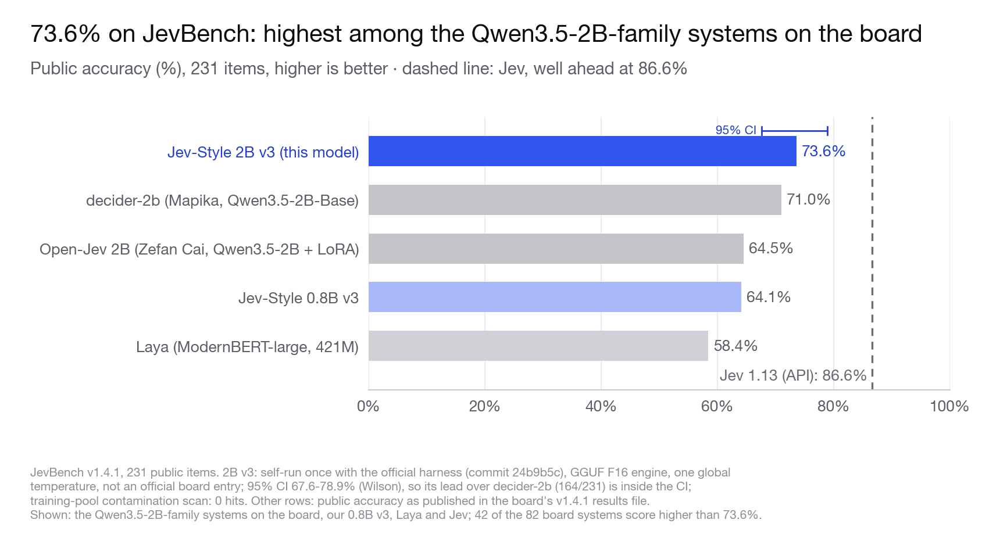
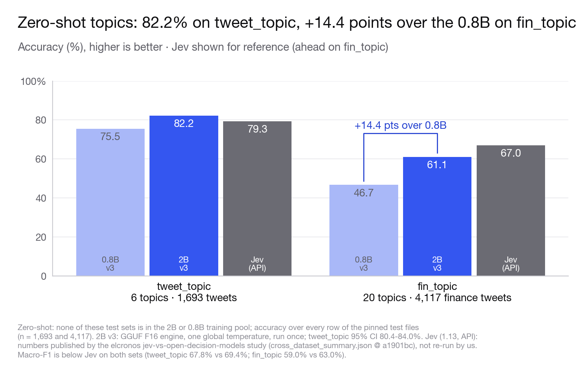

# Jev-Style-2B-Decision-v3-MLX

<!-- jevstyle:project-links:start -->
**Local classification, routing and fixed-choice scoring with JevStyle.**

This is the text-only **2B v3** release (2026-09-27), maintained by Chaoliang Yan; it used no Jev outputs, and its training sources are documented on the main card. The current recommended release is **2B v4** (text and images), which was trained in part on soft labels distilled from TypeSafe Jev 1.14 through its public API. JevStyle is independently maintained, with no TypeSafe affiliation or endorsement. Training provenance is release-specific.

**Official local installation — no hosted API key or agent simulation:** on Apple silicon install `python -m pip install -U "jev-style[mlx]"` and run `jev-style serve --release 2b-v3`; `--release 2b` now selects the 2B v4. The hosted API no longer serves this version. The package runs downloaded JevStyle weights on your machine. [Step-by-step installation and verification](https://jevstyle.com/guides/run-locally/). TypeSafe/OpenRouter Jev access and skills that simulate decisions with another agent model are separate execution paths.

**Hosted service is separate from local inference.** Hosted API: operational. It serves the 2B v4 (text only; 8,192-token context, inputs up to 8,000 tokens). There is currently no fixed per-account quota: no daily request count and no per-minute cap. Capacity is shared, so a busy server answers 429 with a `Retry-After` header and clients should retry. Check [current service status](https://jevstyle.com/api/#service-status) or [live health](https://api.jevstyle.com/healthz) when using the hosted API.

Choose a workflow: [Python text classification](https://jevstyle.com/guides/local-text-classification/), [local routing tools and Apple silicon](https://jevstyle.com/guides/local-decision-models/), [receipt or screenshot yes/no decisions](https://jevstyle.com/use-cases/local-vision-decisions/), [reproducible routing comparison](https://jevstyle.com/benchmarks/banking-routing/). These guides distinguish suitable alternatives and published evidence; they do not establish universal superiority.
<!-- jevstyle:project-links:end -->


**[Try the latest 2B v4 in your browser →](https://huggingface.co/spaces/chaoliangUNSW/jev-style-2b)** (this Space runs the 2B v4; the 2B v3 runs locally from this repository)

**Website:** [jevstyle.com](https://jevstyle.com/models/) · **GitHub:** [jev-style](https://github.com/lawrence3699/jev-style) · **Collection:** [all v3 builds and demos](https://huggingface.co/collections/chaoliangUNSW/jev-style-decision-v3-08b-2b-6ab87f32380cbd8c03b608b9)

**Jev-Style decision series:** [v1 · 2B](https://huggingface.co/chaoliangUNSW/Jev-Style-Qwen3.5-2B-Decision-MLX-bf16) → [v2 · 2B](https://huggingface.co/chaoliangUNSW/Jev-Style-Qwen3.5-2B-Decision-v2-MLX-bf16) → [v3 · 0.8B](https://huggingface.co/chaoliangUNSW/Jev-Style-0.8B-Decision-v3-MLX) → **v3 · 2B**

<!-- PIP_SNIPPET (jev-style 0.3.0, added 2026-09-27; checked against 0.6.3 on 2026-11-05) -->
**Quickest start: the [jev-style](https://github.com/lawrence3699/jev-style) package** (0.6.0 or later; pass `--release 2b-v3`, since `2b` now means the 2B v4; its `[mlx]` extra
installs mlx-lm 0.31.3, the version this runtime requires) downloads these weights and serves a local `/v1/systemone` API:

```bash
pip install "jev-style[mlx]"
jev-style serve --release 2b-v3 --precision 8bit   # or bf16 (the default); http://127.0.0.1:8765
```

```python
from jev_style import JevStyle, choice, noul

js = JevStyle.from_pretrained("chaoliangUNSW/Jev-Style-2B-Decision-v3-MLX", precision="8bit")
out = js.decide("I was charged twice. Please fix this ASAP.", {
    "billing": noul("This ticket is about billing."),
    "tone": choice("What is the customer's tone?", ["calm", "frustrated", "angry"]),
})
print(out["answers"]["billing"]["noul"], out["answers"]["tone"]["choice"])
```

**Jev-style decisions, now at 2B, native on Apple silicon.** These are the MLX builds of
[Jev-Style-2B-Decision-v3](https://huggingface.co/chaoliangUNSW/Jev-Style-2B-Decision-v3): bf16 (3.76 GB) and
8-bit (2.00 GB) in one repository, with one runtime (`jev_style_decision_mlx.py`; choose the folder with `--model-dir bf16` or `--model-dir 8bit`). Full
results, protocols, training data and licences are on the
[main model card](https://huggingface.co/chaoliangUNSW/Jev-Style-2B-Decision-v3).


| Public benchmark | **Jev-Style v3 · 2B** | Jev-Style v3 · 0.8B | Jev 1.13 (API) |
|---|:---:|:---:|:---:|
| JevBench v1.4.1, 231 public items ↑ | 73.6% | 64.1% | 86.6% |
| tweet_topic, zero-shot, accuracy ↑ | 82.2% | 75.5% | 79.3%¹ |
| fin_topic, zero-shot, accuracy ↑ | 61.1% | 46.7% | 67.0%¹ |
| Longest input per call | 25,600 tokens, no option cap | 25,600 tokens | |

<sub>Benchmark numbers of the model, measured with its GGUF F16 build (the pre-declared engine; one global temperature; each benchmark run once). The MLX builds were checked against the same FP32 reference (table below). JevBench: self-run with the official harness, not an official board entry; 95% CI 67.6–78.9% (Wilson). 73.6% is the highest JevBench public accuracy among the Qwen3.5-2B-family systems on the v1.4.1 board (decider-2b 71.0%, open-jev-zefan-2b 64.5%); decider-2b lies inside the CI. Jev is well ahead on JevBench and ahead on fin_topic. ¹ Jev numbers from the elcronos study (raw API), not re-run by us; on tweet_topic the 2B's macro-F1 (67.8%) is below Jev's (69.4%). Details: [main card](https://huggingface.co/chaoliangUNSW/Jev-Style-2B-Decision-v3#results).</sub>

**25,600 tokens, no option cap.** State, questions and every option share one 25,600-token budget; question and
options over 2,048 tokens use a numbered-option catalogue. Nothing is truncated.

## Precisions and parity

| Precision | Folder | Weights | Same top-1 as PyTorch FP32 (1,000 rows) | Max abs Δp | Accuracy (FP32: 80.8%) | Long fixture (43 questions) | Gate |
|---|---|---:|---:|---:|---:|---:|:---:|
| **bf16** (default) | `bf16/` | 3.76 GB | **99.7%** | 0.035 | 80.5% | **43 / 43** | PASS |
| **8-bit** (affine, group size 64) | `8bit/` | 2.00 GB | **99.6%** | 0.162 | 80.8% | **43 / 43** | PASS |

- Each folder holds `model.safetensors`, its `config.json`, the tokenizer and `macjev_norms_fp32.safetensors`
  (FP32 norm weights, 0.42 MB, required). The top level holds the shared runtime `jev_style_decision_mlx.py`,
  `readout_config.json`, `release_config.json`, the sha256 `manifest.json`, `LICENSE`, `NOTICE`,
  `THIRD_PARTY_NOTICES.md` and a copy of `bf16/config.json` (for the Hub's download counter). Converted with mlx
  0.32.2 and mlx-lm 0.31.3.
- The 8-bit build makes the same call as full precision on 99.6% of the 1,000 rows at about half the size.
- **Which folder:** `bf16/` for closeness to the FP32 reference (max abs Δp 0.035 vs 0.162); `8bit/` when memory is
  tight.

<sub>Reference: HF FP32 on CPU, exact block attention, on the released bf16 checkpoint; gates declared before any format was scored. 1,000 real development rows (≤4,096 tokens) test agreement between formats. Long fixture: 35 requests / 43 questions up to 25,600 tokens, including catalogue-overflow questions and up to 151 options. Sizes are the weight files (GB = 10^9 bytes).</sub>

<!-- LATENCY:BEGIN generated from latency_2b.json (validation/latency_2b.json in the main repository); do not edit by hand -->

## Speed

**Read once, then ask.** On an Apple M1 Max (MLX bf16), the first question about a 24,501-token input took 15.5 s; a further question about the same state took 0.15 s, because the state is computed once and reused (medians). Ten questions about that state in one call took 16.2 s.

| State | Questions per call | MLX bf16 | MLX 8-bit |
|---|---:|---:|---:|
| 878 tokens | 1 | 0.57 s | 0.72 s |
| 878 tokens | 10 | 1.07 s | 1.27 s |
| 3,950 tokens | 1 | 2.26 s | 2.96 s |
| 3,950 tokens | 10 | 2.80 s | 3.54 s |
| 24,436 tokens | 1 | 15.5 s | 19.9 s |
| 24,436 tokens | 10 | 16.2 s | 20.8 s |
| 24,436 tokens, already computed | 1 | 0.15 s | 0.16 s |

- Pick a precision folder by size and closeness to FP32 (Precisions table above). bf16 and 8-bit were timed one after another on the same shared machine; in these runs 8-bit was the slower folder in every row (indicative only).

<sub>Apple M1 Max, 64 GB, macOS 15.7.5. Wall time around one `decide` / `score_many` call (tokenisation included), median of 3 calls with the state recomputed each time; the model was loaded beforehand (loading took 3.1–3.7 s here, not included). States: English documentation and source code of 878, 3,950, 24,436 tokens plus the question; 10 questions = 4 choice, 4 true/false and 2 score questions about the same state in one call; with the question and options each input was up to 943, 4,015 and 24,501 tokens. MLX: mlx 0.32.2 / mlx-lm 0.31.3. Results were identical with and without a precomputed state. Other jobs shared the machine during these runs (1-minute load average 5.5–8.6 at the end of each run), so treat the numbers as indicative. All rows here were measured in one session (2026-09-27 03:21–03:28 AEST); an earlier run of the same rows (00:37–00:45 AEST, load average 11.8–27.5) was discarded because other jobs had slowed it (its times were up to 2.1× longer).</sub>

<!-- LATENCY:END -->

## Quick start

```bash
pip install -U huggingface_hub
hf download chaoliangUNSW/Jev-Style-2B-Decision-v3-MLX --local-dir Jev-Style-2B-Decision-v3-MLX
cd Jev-Style-2B-Decision-v3-MLX
pip install -r requirements.txt        # mlx 0.32.2, mlx-lm 0.31.3 (exactly), transformers 5.17.0, tokenizers, numpy
```

Only one precision is needed: add `--exclude "8bit/*"` to the download for bf16 only, or `--exclude "bf16/*"` for
8-bit only. Pass the precision folder to the runtime with `--model-dir bf16` or `--model-dir 8bit` (in Python,
`JevStyleDecisionMLX("bf16")` or `JevStyleDecisionMLX("8bit")`).

```bash
# choice question, bf16 weights
python jev_style_decision_mlx.py --model-dir bf16 --state "Finder is open on ~/Reports. The user asked: email report.pdf to Ana." \
  --question "What should the agent do next?" \
  --options '{"attach_report": "attach report.pdf to a new email to Ana", "rename_report": null, "close_finder": "close the Finder window"}'

# true/false question about a JSON state, 8-bit weights
python jev_style_decision_mlx.py --model-dir 8bit \
  --state-json '{"app": "Mail", "draft": {"to": "ana@example.com", "attachments": []}}' \
  --question "Is the report attached?" --qtype noul

# score (ordinal) question, uncalibrated probabilities (T = 1.0)
python jev_style_decision_mlx.py --model-dir 8bit --state "The deploy failed twice with the same migration error." \
  --question "How risky is retrying now?" --qtype score --options '["no risk", "some risk", "high risk"]' --temperature 1.0

# full typed question as JSON, first checking the sha256 of the runtime files and the chosen precision folder (manifest.json)
python jev_style_decision_mlx.py --model-dir bf16 --verify --state "cart: 3 items" \
  --question '{"t": "choice", "ins": "Next step?", "crit": {"checkout": null, "keep_shopping": null}}'
```

The output has `answer`, `probabilities` and raw `scores` per option, `temperature` (0.8279, the calibrated global
temperature), `top_probability`, `entropy_concentration`, `input_tokens`, `state_tokens`, `head_tokens`, `blocks`
and `catalogue_overflow`.

```python
from jev_style_decision_mlx import JevStyleDecisionMLX
m = JevStyleDecisionMLX("8bit")                # the 8-bit precision folder
state = {"screen": "Settings > Wi-Fi", "goal": "join the network Office-5G"}
qs = [{"t": "choice", "ins": "Next action?", "crit": {"tap_office_5g": None, "toggle_wifi_off": None, "go_back": None}},
      {"t": "noul", "ins": "Is Wi-Fi turned on?", "crit": None}]
for r in m.score_many(state, qs):          # the state is computed once and reused for every question
    print(r["answer"], round(r["top_probability"], 4))
m.decide(state, qs[0])                     # same state again: reused (m.last_timing["state_reused"] is True)
m.close()
```

- Batch mode: `--jsonl requests.jsonl` (or `-` for stdin), rows `{"id"?, "state", "question", "options"?, "qtype"?,
  "temperature"?}`; consecutive rows with an identical state share one state computation, and a malformed row gets
  an `"error"` field while the batch continues.
- **Long inputs.** The complete input can be up to 25,600 tokens, with no separate question/options cap. In our
  smoke test a 22,005-token state with 100 described options ran as 25,393 tokens in 14 blocks, using the
  catalogue layout. A larger input raises `InputBudgetError` (CLI exit status 2); nothing is truncated.
- **mlx-lm must be exactly 0.31.3.** The runtime corrects two Qwen3.5 numerics inside mlx-lm and checks the source
  it patches; other versions are refused with the install command. It also refuses to run without
  `macjev_norms_fp32.safetensors` or `readout_config.json`, and never falls back to stock norms or T = 1.
- The input format, block attention and the readout are described on the
  [main card](https://huggingface.co/chaoliangUNSW/Jev-Style-2B-Decision-v3#input-format-and-readout).

## Scope and limits

- **Runtime required.** `mlx_lm.generate` can load the weights in `bf16/` or `8bit/` (the
  repository root holds no weights) but still cannot produce the decision scores, and it would run causal attention.
  Use `jev_style_decision_mlx.py`.
- **25,600 tokens** is the limit for the whole input (state + question + options + readout).
- **Reduced-data training.** The model was trained on a reduced data pool (60M tokens).
- **Decision Index.** Our own complete run of Decision Index 0.2.1 scored **34.83**
  ([chaoliangUNSW/decision-index-results](https://huggingface.co/datasets/chaoliangUNSW/decision-index-results)); the public [board](https://huggingface.co/spaces/multimodalart/jev-decision-index) listed the 2B v3 (Public
  index 34.05) until 2026-11-04, when the 2B v4 replaced it. The training pool includes the train splits of 7 of its benchmarks and
  format-imitating data for 7 more, so results on these are not zero-shot; the 14 benchmarks that are not zero-shot
  for this model are named on the [main card](https://huggingface.co/chaoliangUNSW/Jev-Style-2B-Decision-v3#scope-and-limits).

<details>
<summary><strong>Results charts</strong></summary>





<sub>Protocol notes are under each chart and on the main card. Plotted values and sources: [jevbench.data.json](figures/jevbench.data.json), [zeroshot.data.json](figures/zeroshot.data.json).</sub>

</details>

## Disclaimers and licence

Apache-2.0. Built on Qwen/Qwen3.5-2B (Apache-2.0); `NOTICE` lists the modifications. Some training data has
restrictive or unclear terms (for example research-only jailbreak prompts and share-alike CC BY-SA sources), and some
training rows are outputs of OpenAI GPT and Anthropic Claude models, whose providers' terms of use may restrict how
models trained on them may be used. See [Training data and
licences](https://huggingface.co/chaoliangUNSW/Jev-Style-2B-Decision-v3#training-data-and-licences) on the main card.
The runtime contains a modified copy of one mlx-lm 0.31.3 function (the Qwen3.5 `GatedDeltaNet.__call__`; MIT License,
Copyright Apple Inc.); its copyright and permission notice is in `THIRD_PARTY_NOTICES.md`. Not affiliated with,
endorsed by or connected to TypeSafe AI or Jev (no Jev weights, code or outputs are used), the Laya authors or the
Qwen team.

**AI disclosure:** code written with AI coding assistants (Claude Code) under my direction; I designed the project,
trained the models and verified the results.

## Contact

I welcome internship, employment, and research collaboration opportunities. Please contact me at [**yanchaoliang369@gmail.com**](mailto:yanchaoliang369@gmail.com).

欢迎提供实习、工作及科研合作机会，请邮件联系：[yanchaoliang369@gmail.com](mailto:yanchaoliang369@gmail.com)。
